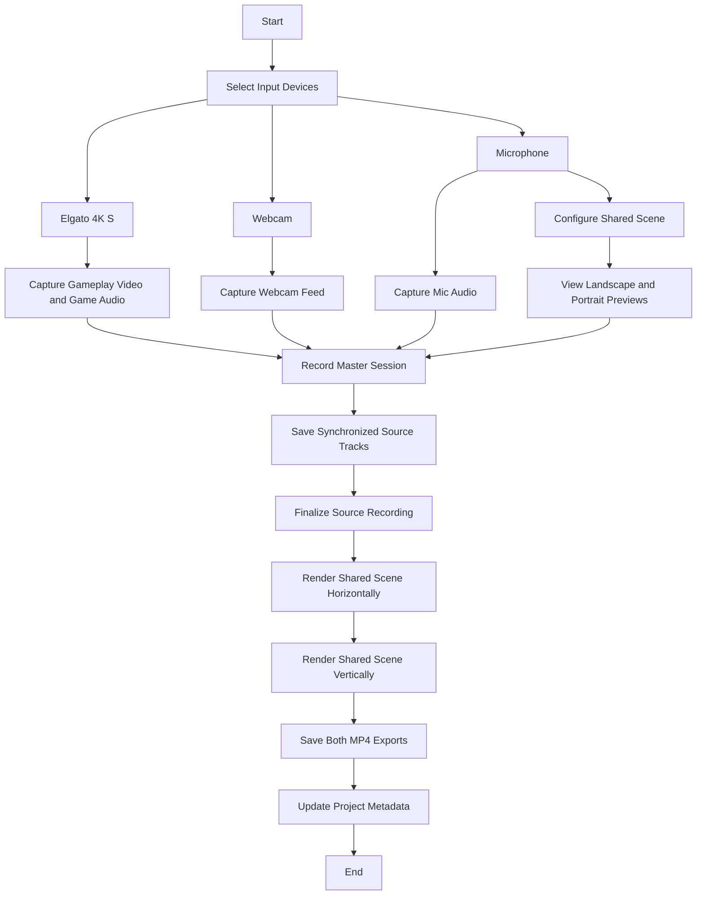

Configure one shared layer list while arranging each layer independently in the landscape and portrait previews. New layers start centered in each preview, using the same output-pixel sizes without fitting to fill the vertical frame; layers may extend beyond the frame after placement changes. Saved scenes initialize Portrait from Landscape at the same pixel sizes, centered in the Portrait frame, then preserve independent Portrait edits. Moving or resizing a layer affects only the preview being edited; both layouts use the same enabled layers and layer order. Each preview can be paused independently to stop rendering its live layers; this does not change the recording or export. Source capture and file writing run in the C++ media core; Electron renders the shared layer list sequentially for each selected layout after the source file is finalized. Export failures leave the source recording available.

While the two exports are rendered sequentially, the app shows a blocking progress dialog with individual layout status and a single overall percentage bar. Progress is based on FFmpeg's processed output timestamp. The compositor restores each recorded video and audio track's capture-clock start offset so the filters do not shift speech out of sync with the camera. When both exports complete, the same dialog displays their saved paths and stays open until closed. The export mix compresses and boosts microphone audio, then uses it to duck game audio while speech is present. The source audio tracks in `master.mkv` are preserved unchanged.

Quitting during recording first finalizes the source file, then waits for both layout exports to finish before closing. If finalization or export fails, the app offers to stay open so the user can retry or inspect the recording; choosing to quit anyway may leave incomplete output files.

The left sidebar's Export layouts selection defaults to both formats and requires at least one format. It controls which MP4s are rendered; the synchronized source recording remains shared. Run `npm run test:recording-flow` for a one-minute synthetic end-to-end recording, finalization, export, and media-probe check. Use `-- --duration-ms=60000 --exports=both --keep` to set the duration, choose `both`, `horizontal`, or `vertical`, and retain test artifacts. The test requires a built `core/build/bin/creator-media-core` and `ffprobe`.
